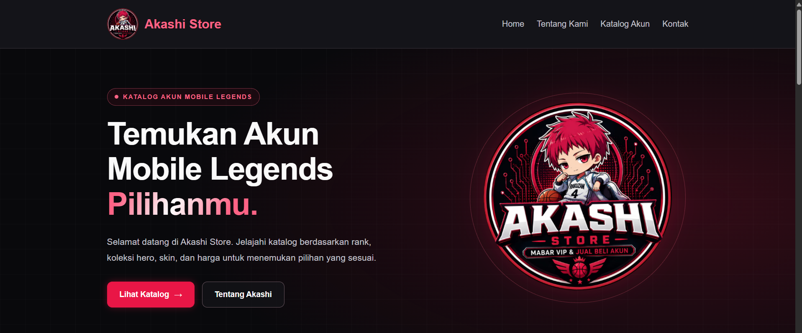
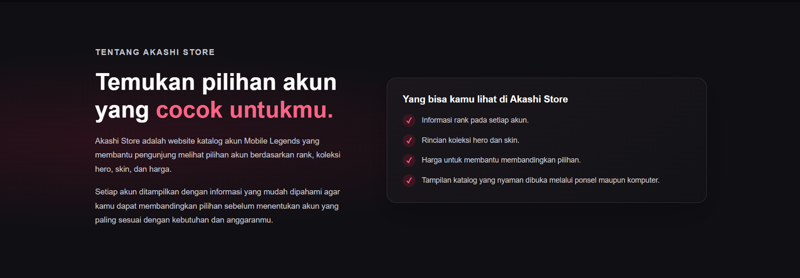
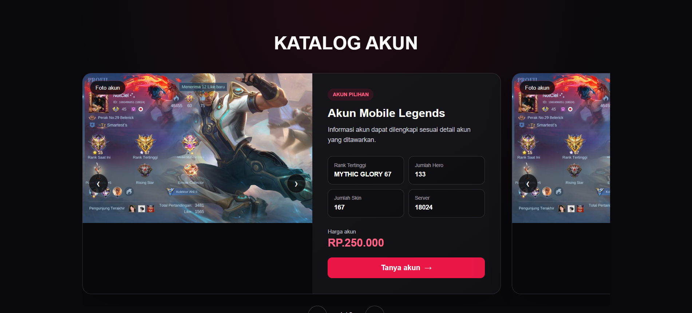
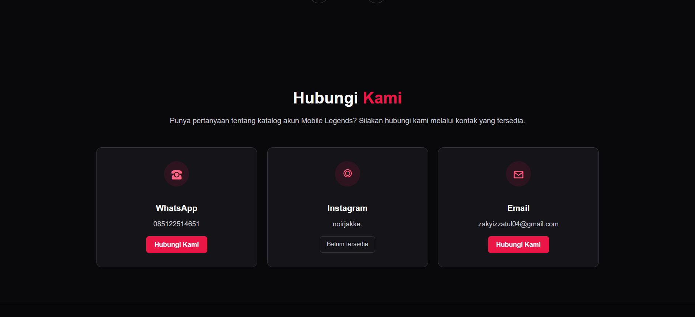

# Akashi Store: Katalog Akun Mobile Legends

Website statis katalog akun Mobile Legends yang dibuat sebagai mini project **Weekly Meet Catalyst** (Final Assignment).

> Website ini merupakan demonstrasi untuk mini project Catalyst. Seluruh data akun yang digunakan bersifat fiktif.

## Deskripsi

Akashi Store adalah website satu halaman (single-page) yang menampilkan katalog akun Mobile Legends. Pengunjung dapat melihat rank, jumlah hero dan skin, server, dan harga setiap akun, lalu menghubungi kontak yang tersedia untuk bertanya lebih lanjut. Navigasi antarsection dilakukan melalui navbar dan footer.

## Latar Belakang dan Tujuan

Memilih akun Mobile Legends biasanya membutuhkan perbandingan rank, koleksi hero, skin, dan harga. Akashi Store dibuat untuk menyajikan informasi tersebut dengan cara yang mudah dibaca dan dibandingkan.

Tujuan project ini:
- Membangun website statis yang berfungsi dengan HTML, CSS, dan JavaScript dasar.
- Menerapkan workflow kolaborasi GitHub: issue, branch, commit, pull request, dan review.
- Membiasakan pembagian tugas dan tanggung jawab dalam tim developer.

## Fitur

- **Navbar** dengan tautan ke setiap section. Navbar tetap terlihat saat halaman di-scroll dan menyesuaikan layar ponsel.
- **Home / Hero** berisi pengenalan Akashi Store, tombol menuju katalog, dan tiga kartu informasi. Animasi logo dinonaktifkan di layar kecil.
- **Tentang Kami** berisi latar belakang, visi, dan misi Akashi Store.
- **Katalog Akun** berisi daftar akun yang bisa digeser dengan tombol panah atau drag. Setiap akun memiliki galeri foto dan spesifikasi: rank tertinggi, jumlah hero, jumlah skin, server, dan harga.
- **Kontak** melalui WhatsApp, Instagram, dan email.
- **Footer** berisi navigasi cepat dan informasi hak cipta.
- Animasi dinonaktifkan bagi pengguna yang mengaktifkan pengaturan *reduced motion*.

## Teknologi

- HTML5
- CSS3 (custom properties, Flexbox, Grid, media query, animasi)
- JavaScript dasar (tanpa framework atau library)

## Struktur Folder

```
akashi-store/
├── index.html      # halaman utama (HTML, CSS, dan JavaScript)
├── logo.jpeg       # logo Akashi Store
├── slide1.jpeg     # foto akun
├── slide2.jpeg     # foto akun
├── README.md
└── screenshots/    # dokumentasi tampilan website
```

## Cara Menjalankan Secara Lokal

Website ini tidak memerlukan instalasi tambahan.

1. Clone repository ini:
   ```bash
   git clone https://github.com/Zukchan/akashi-store.git
   cd akashi-store
   ```
2. Buka file `index.html` langsung di browser, atau jalankan local server:
   ```bash
   python -m http.server 8000
   ```
   Lalu buka `http://localhost:8000` di browser. Di macOS/Linux, gunakan `python3`.

Pastikan semua file gambar berada di folder yang sama dengan `index.html`.

## Anggota Kelompok

Kelompok: Hunter

| Nama | Username GitHub | Bagian |
|---|---|---|
| Zaky Izzatul Zulfia | @Zukchan | Navbar & Home / Hero |
| Randy Fadlan Sophian | @randyfadlansop-hub | About / Profile |
| Dede Wahyudin | @hafigg | Main Content (Katalog Akun) |
| Ahmad Nur Latif | @ahmadnurlatif | Contact & Footer |

## Pembagian Tugas dan Kontribusi

**Zaky Izzatul Zulfia - Navbar & Home / Hero**
- Branch: `feature/homepage`
- Issue:
  - #8 Perbaiki navbar agar responsif dan semua link berfungsi
  - #9 Rapikan hero dan homepage
- Pull Request: https://github.com/Zukchan/akashi-store/pull/6

**Randy Fadlan Sophian - About / Profile**
- Branch: `feature/about`
- Issue:
  - #10 Lengkapi latar belakang, visi, dan misi di section About
  - #11 Samakan penamaan dan periksa tampilan About di layar kecil
- Pull Request: https://github.com/Zukchan/akashi-store/pull/7

**Dede Wahyudin - Main Content (Katalog Akun)**
- Branch: `feature/main-content`
- Issue:
  - #12 Lengkapi data Akun #2 dan Akun #3
  - #13 Ganti foto agar setiap akun memiliki foto sendiri
- Pull Request: https://github.com/Zukchan/akashi-store/pull/5

**Ahmad Nur Latif - Contact & Footer**
- Branch: `feature/contact`
- Issue:
  - #14 Perjelas kontak Instagram
  - #[nomor] Rapikan CSS footer dan label navigasi
- Pull Request: https://github.com/Zukchan/akashi-store/pull/4

**Bersama:** README dan screenshot. PIC: [nama].

## Alur Kerja Git

- Buat branch dari `main` dengan format `feature/nama-fitur`.
- Commit perubahan yang relevan, lalu push ke GitHub.
- Buat Pull Request ke `main`. Tulis `Closes #nomor` di deskripsi PR agar issue otomatis tertutup saat PR di-merge.
- Setiap Pull Request direview minimal oleh satu anggota lain sebelum di-merge.
- Branch `main` selalu berisi versi website yang dapat dijalankan.

## Screenshot

Dokumentasi tampilan website tersimpan di folder `screenshots/`.






---

Dibuat untuk Weekly Meet Catalyst, 2026.
